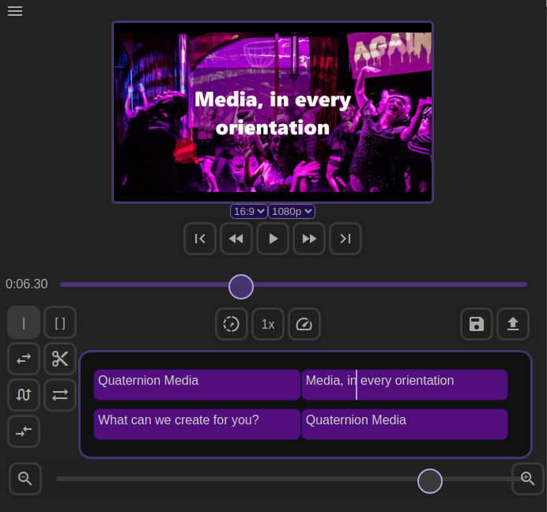

### Automate your video workflow

**Alfred** is a cloud based video production suite, allowing you to:

- Create videos automatically from a template
- Design new templates, or customize existing ones
- Edit multitrack timelines
- Render projects to multiple formats and resolutions
- Generate videos automatically based on rules
- Integrate into existing video platforms
- Work from any device, including mobile browsers

With the power a distributed server rendering process, **Alfred** is a scalable solution for any size production!

[Contact us](/contact) for a demo, or find out more information about the project below!

[Alfred](/alfred)

Automatic video creation
