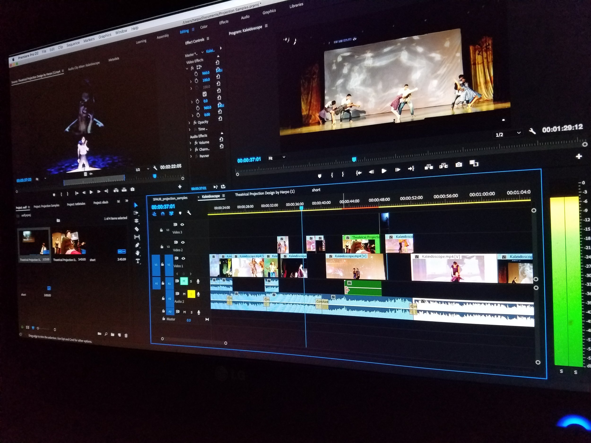
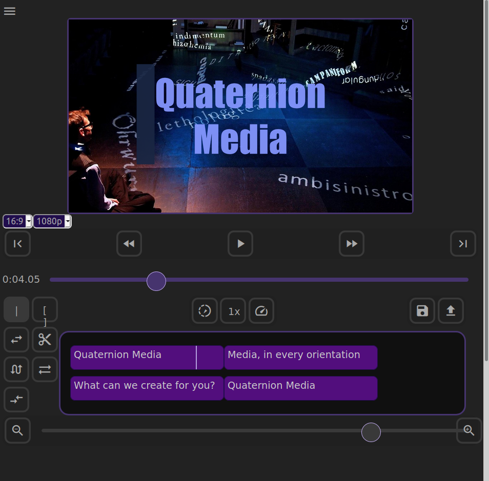
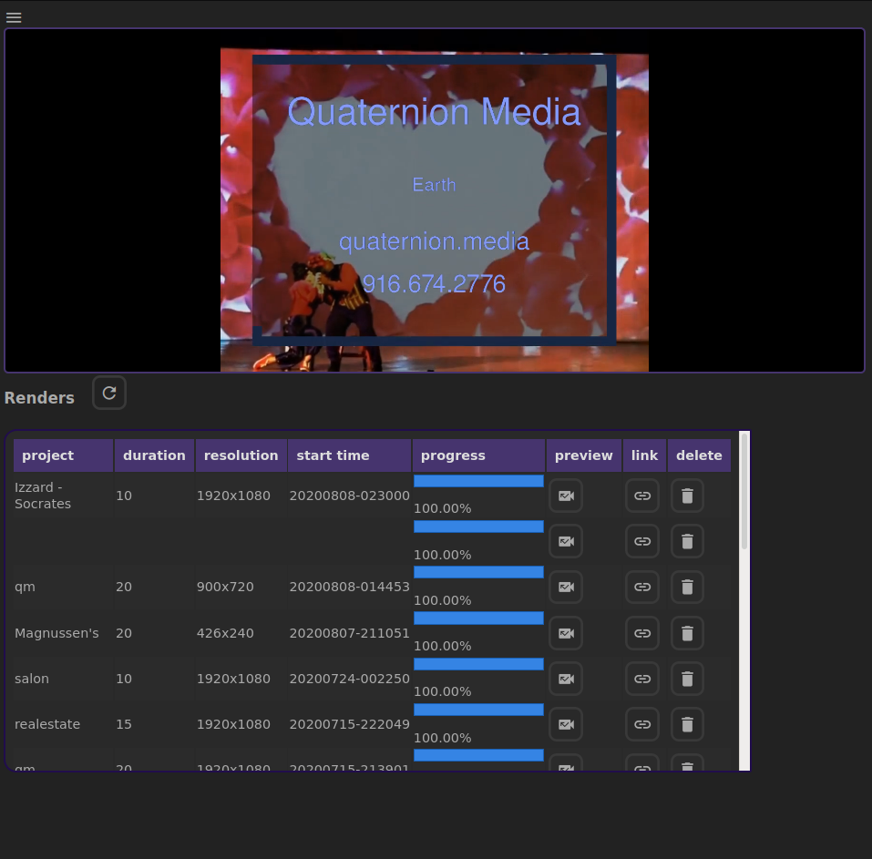
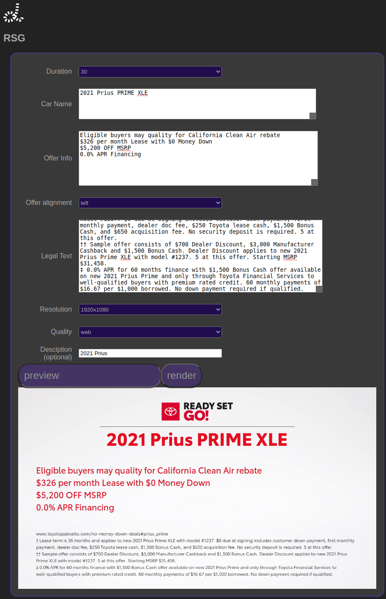

# Most video editing software is:

- ### **Expensive**

Modern professional video editing tools can range from a few hundred to a few thousand dollars, depending on your needs. Even cloud applications like Adobe Premiere costs $20.99/ month, or **over $250 / year, per user!**

- ### **Hardware intensive**

Most modern video software must be run on a powerful computer, and preferably a desktop. There are a few mobile and cloud-based video editing tools available, but they tend to be expensive and feature limited, and sometimes both.

- ### **Difficult to share projects**

Sharing a video project across any two computers requires synchronization of both the project file, and all the media files (including fonts and plugins). Unless you are sharing a hard drive or have an advanced media server in place, don’t bother.

- ### **Limited to a solo editor**

Want to work on a project at the same time as someone else? That’s a hard “Nope!” Unless you’re keeping separate project files, in which case you are technically working on separate projects.

- ### **Single platform**

Even if your software supports multiple operating systems, file sharing can be more headache than it’s worth, and can even lead to file corruption if not careful!

- ### **Edited manually**

All editing is done by hand with a **mouse** and a **keyboard**, with an experienced (and usually expensive) professional. Automation tasks are possible, but anything more complicated than batch processing whole video files is a rarely possible.

*Adobe Premiere* has some limited scripting capabilities, but requires knowledge of their proprietary API, which itself requires extensive coding knowledge.

- ### **Render intensive**

Once you are done editing your video, it must be finalized, which can take hours (or days) depending on the length and complexity of the project.

Unless you have a sophisticated networked renderer set up, your computer will be working at 100% capacity until it finishes (or fails overnight until restarted manually)

# ***Alfred***

By comparison, ***Alfred*** is a web-based video application, with a cloud-based rendering engine, allowing you to make changes in real-time and share with others.

## **Features**

- ### **In-browser**

Leveraging the power of HTML5 and modern web tools, you can use any device to create content, including mobile browsers!

- ### **Cloud rendering**

All rendering happens on our powerful servers, so your devices can be free to do everything else, including editing more videos!

- ### **Scalable pricing**

With ***Alfred***, all editing and previewing is free! Only pay for what you render on our servers.

Need more rendering power? Our distributed backend scales up automatically as load increases.

- ### **Easy to share**

Since Alfred is built on the web, sharing is as easy as using the app. Securely share projects with other collaborators and send finished videos to any social media platform!

- ### **Real-time Collaboration**

*Coming soon!* Edit video collaboratively in real-time with others! Share with others while editing the same project at the same time!

- ### **Platform agnostic**

Works on all modern browsers across all operating systems!

- ### **Automated**

Apply rules on media sets to automatically create content based on any criteria! Create workflows to effortlessly repeat common tasks, or chain them together to create all new ways of working!

Alfred is even capable of creating videos from data pipelines, or automatically based on requirements you specify.

### For example:

- Generate animated titles based on a user-submitted form
- Convert a list of photos and videos into a slideshow
- Superimpose a logo onto an incoming stream of content
- Render a project in multiple aspect ratios for different social media networks
- Create multiple unique supercuts from a selection of media, without repeating content

These are only a few examples of what is possible with a tool like this. The only real limit is the imagination!

### [Contact us](mailto:alfred@quaternion.media?subject=Alfred%3A%20new%20quote&) to learn more about how ***Alfred*** can automate your video workflow.
