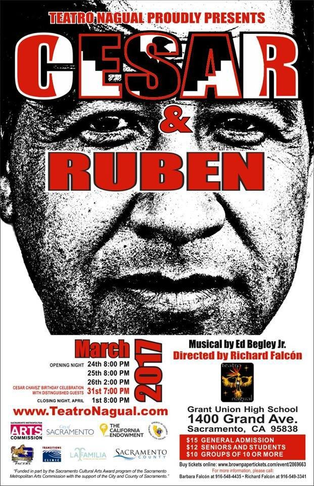
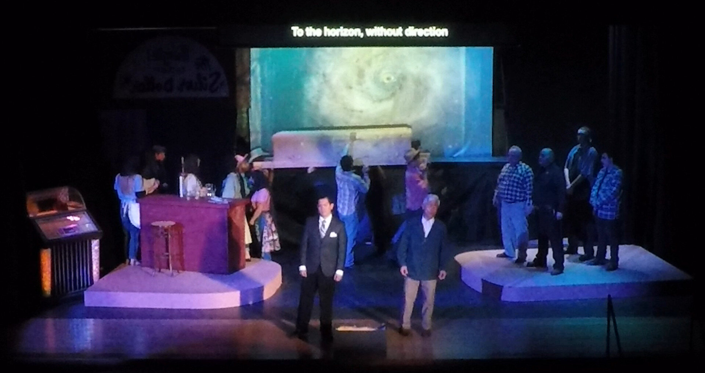
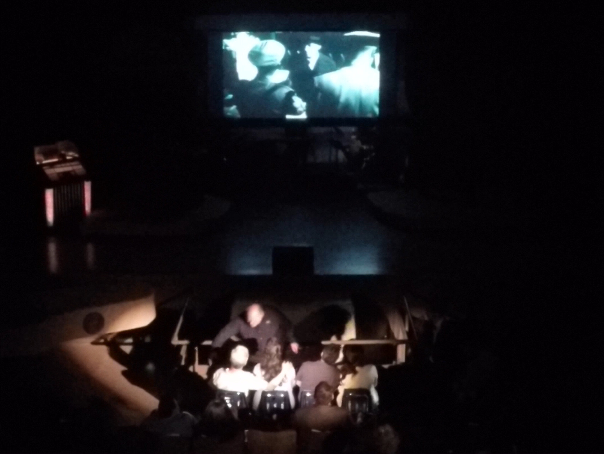
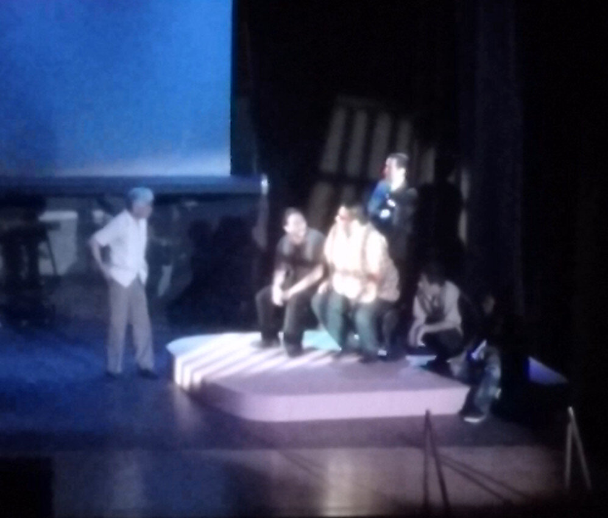
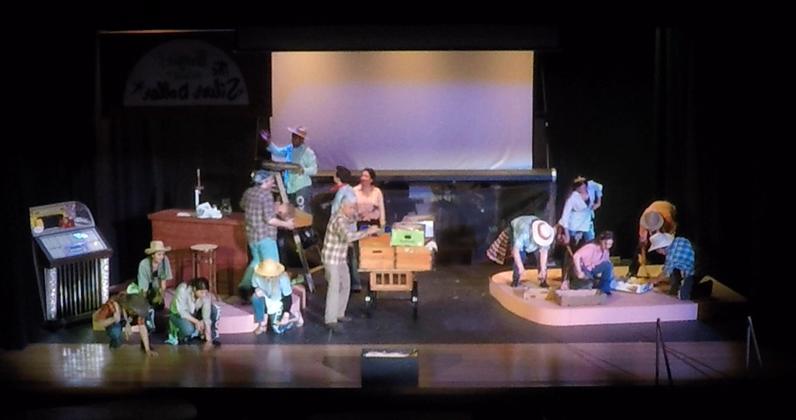
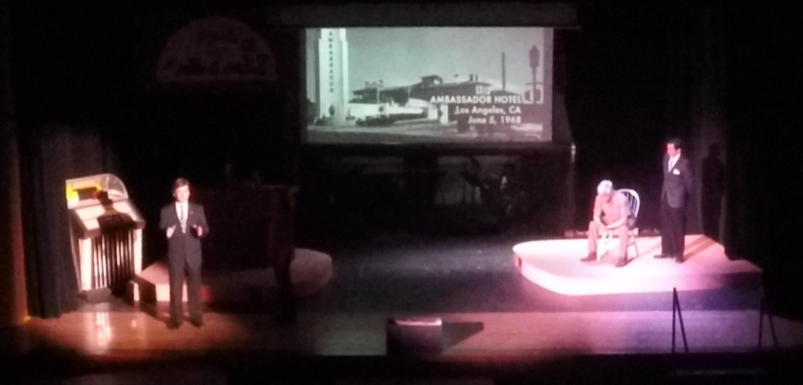
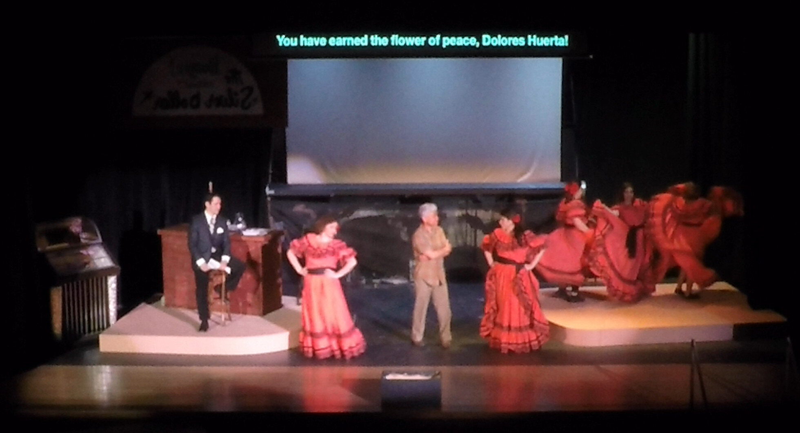
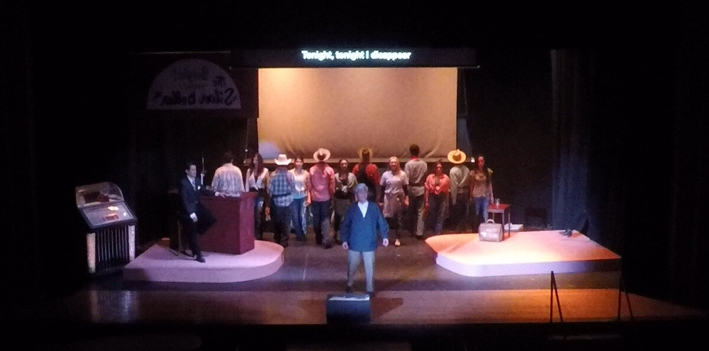
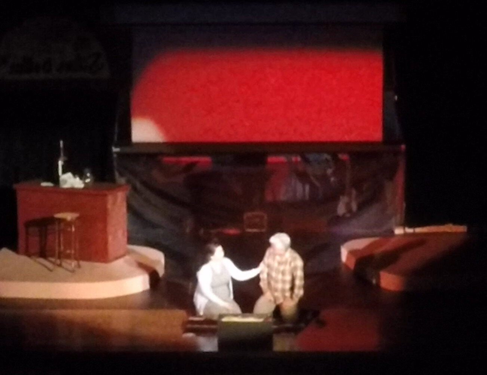
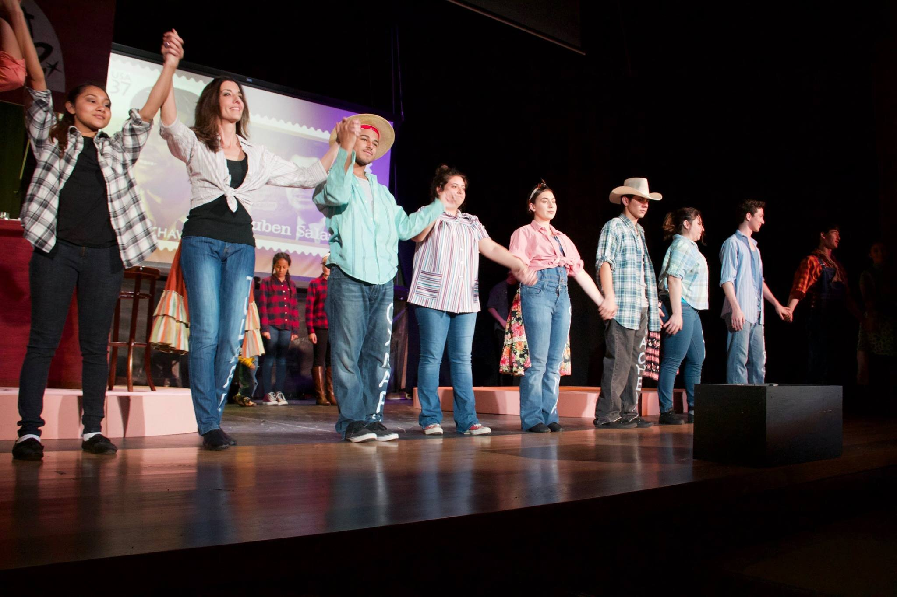

Regional theatrical premiere of [Ed Begley Jr.](https://en.wikipedia.org/wiki/Ed_Begley_Jr.)’s musical about the life of Cesar Chavez, and his efforts with reporter Ruben Salazar to aid farm workers in gaining fair wages and treatment in early 1960s California. The show is presented in English and Spanish, with songs in Spanish and English supertitles

Scope provided:

- Technical design
- Lighting design
- Sound design
- Projection design
- Supertitle design
- Music direction

Performances included a special presentation on the 90th anniversary of Cesar Chavez's birthday, with [members of the Chavez family in attendance.](https://ufw.org/chavez-family-sacramento-gala-performance-cesar-ruben-ed-begley-jr-s-musical-chavezs-life-spirit/)

