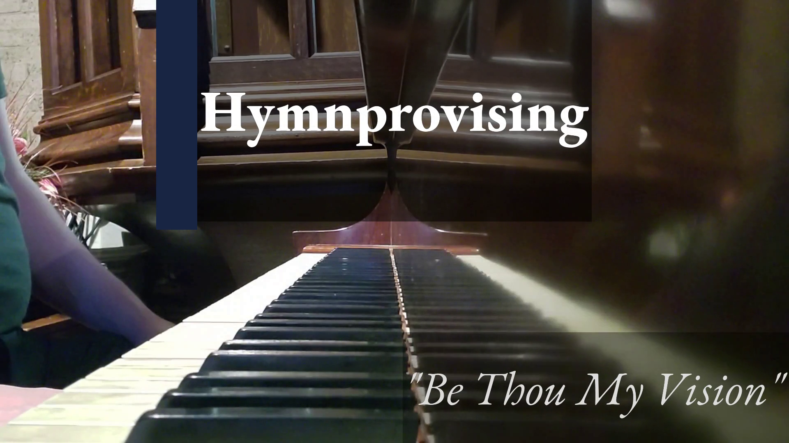

# Hymnprovising

## Improvising on hymns

We’re kicking off a new video series of (mostly) daily musical improvisations, based on common hymns. Each one is a unique interpretation of the piece, performed in any number of different styles.

The series is released for free on youtube, and an updating playlist of them all can be found at the project site below.

[Hymnprovising](/hymnprovising)

Improvising on hymns
