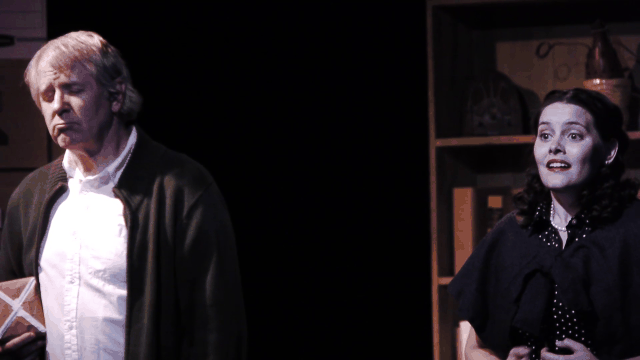

Julia Cho's *The Language Archive* explores a lexicographer's struggles saving dying languages, while he tries to find the right words to express himself and save his struggling marriage.

Produced by Big Idea Theatre

July 2014 - Sacramento, CA

<iframe src="https://www.youtube.com/embed/zx8eBxkNzMk" frameborder="0" allowfullscreen></iframe>

